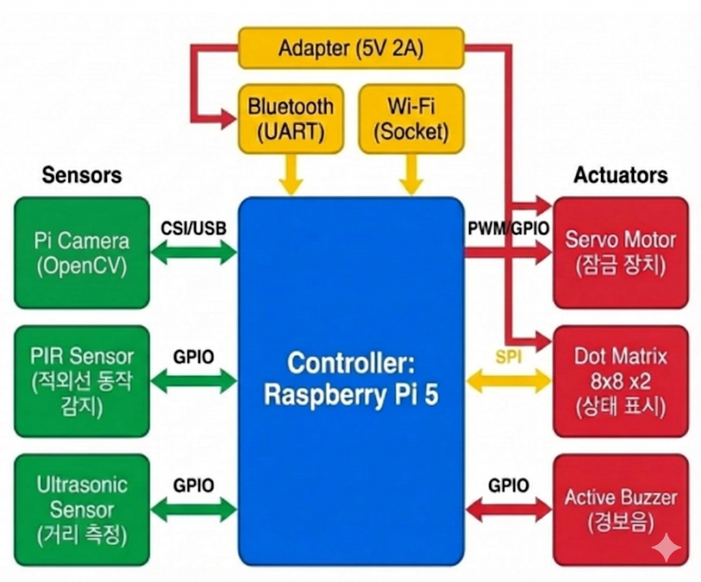
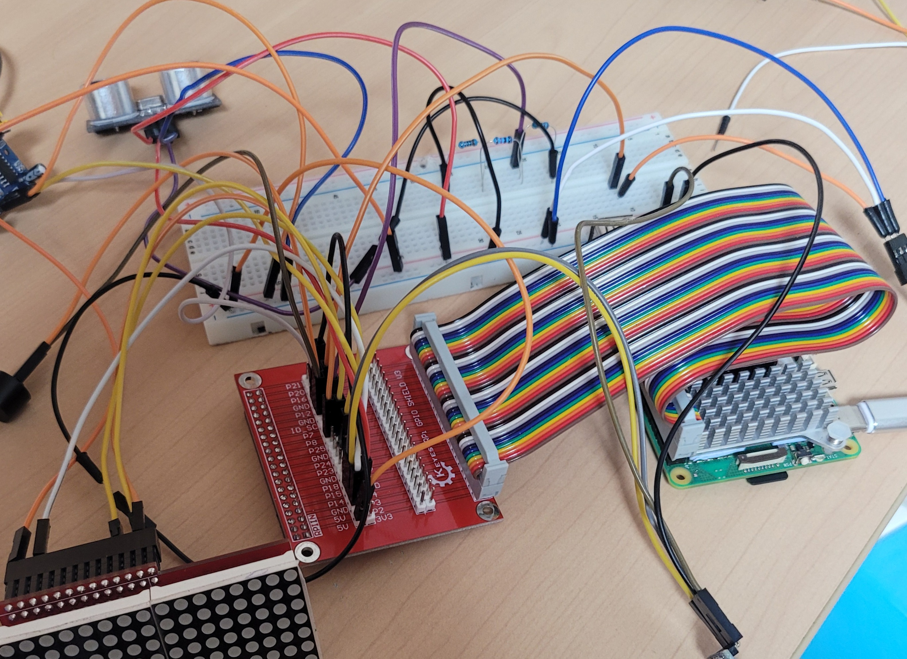

# RaspberryPi_Sentry-System
3학년 2학기 임베디드 시스템 Team Project | 라즈베리파이 5 기반 지능형 보안 시스템

<br>

## 1. 개요
- **프로젝트 성격:** 라즈베리파이 5의 고성능 컴퓨팅과 다중 센서를 융합하여 침입 감지부터 능동적 경고 및 원격 제어까지 수행하는 임베디드 보안 시스템
- **주요 기능:**
  - 카메라 이미지 변화 검출(OpenCV) 및 PIR 센서를 활용한 이중 침입 감지
  - 초음파 센서를 통한 50cm 이내 근접 위협 감지 시 자동 사진 캡처 및 증거 확보
  - 상황별(SAFE, WARN, DANGER) 시각적 아이콘(Dot Matrix) 표시 및 경보음(Buzzer) 송출
  - UART(Bluetooth) 통신 기반 사용자 인증 및 서보 모터(도어락) 원격 제어
  - Socket 통신 기반 실시간 침입 로그 서버(Wi-Fi) 전송

<br>

## 2. 시스템 아키텍처

### 하드웨어 및 통신 구조도



### 주요 하드웨어 및 인터페이스
- **제어 보드:** Raspberry Pi 5 (Raspberry Pi OS)
- **센서:** Pi Camera (OpenCV 영상 처리), PIR Sensor (동작 감지), Ultrasonic Sensor (거리 측정)
- **액추에이터:** Dot Matrix 8×8 2개 (상태 UI 출력), Active Buzzer (경보음), Servo Motor (잠금 장치)
- **통신:** UART (Bluetooth), SPI (Dot Matrix), PWM/GPIO (Servo & Sensors), Socket (Wi-Fi)

<br>

## 3. 핵심 기능

### 1) 5-Thread 병렬 처리 아키텍처
각 하드웨어 모듈과 통신 모듈을 독립적인 POSIX 쓰레드로 분할하여, 특정 액추에이터의 블로킹 딜레이(예: 부저 멜로디 출력)가 센서의 실시간 감지나 사용자 명령 수신을 방해하지 않도록 설계했습니다.

```c
// [src/main.c] 5개의 독립 쓰레드 생성 및 병렬 구동
pthread_create(&th_disp, NULL, displayThreadFunc, NULL);
pthread_create(&th_buzz, NULL, buzzerThreadFunc, NULL);
pthread_create(&th_pipe_reader, NULL, opencvPipeReadThread, NULL);
pthread_create(&th_bt, NULL, bluetoothThreadFunc, NULL);
pthread_create(&th_wifi, NULL, wifiServerThreadFunc, NULL);
```

### 2) IPC (Named Pipe) 및 Mutex 동기화
- **IPC (FIFO):** 영상 처리에 최적화된 Python과 하드웨어 정밀 제어에 최적화된 C 언어 간 Named Pipe(`/tmp/opencv_fifo`)를 구축하여 이종 언어 간 실시간 데이터를 연동했습니다.
- **Mutex:** 여러 쓰레드가 전역 변수인 시스템 상태(`current_mode`) 및 인증 정보에 동시 접근 시 발생하는 경쟁 상태(Race Condition)를 방지하기 위해 `mode_mutex`와 `auth_mutex`를 적용했습니다.

```c
// [src/sensors.c] IPC 파이프 수신 시 Mutex를 통한 공유 자원 보호
if (read(fd, buffer, 1) > 0) {
    pthread_mutex_lock(&mode_mutex);
    if (buffer[0] == '1') opencv_motion_detected = 1;
    else opencv_motion_detected = 0;
    pthread_mutex_unlock(&mode_mutex);
}
```

<br>

## 4. 트러블슈팅

### ① UART-SPI 핀 간섭 및 전압 노이즈로 인한 시스템 통신 단절
- **Symptom:** 블루투스(UART) 활성화 시 SPI 핀 간섭으로 도트매트릭스 작동이 멈춤. 또한, 서보 모터 구동 시 전압 노이즈가 발생하여 블루투스 페어링이 간헐적으로 해제됨.
- **Root Cause:** 라즈베리파이의 기본 핀 기능 중복 설정 및 전원부(GND) 단일 회로 공유로 인한 모터의 과도한 돌입 전류(Inrush Current) 전압 강하 현상.
- **Resolution:** 하드웨어 핀 매핑 재배치로 통신 라인을 분리하고, 모터 구동용 외부 어댑터 전원을 직결하여 전원부를 분리함. 추가로 도트매트릭스의 전류 소모를 줄이기 위해 소프트웨어적으로 밝기(Brightness) 계수를 하향 조정하여 통신 신뢰성 확보.

<br>

### ② PIR 센서 출력 불안정(Flickering) 및 감지 오류
- **Symptom:** 객체가 범위 내에 머물러 있음에도 PIR 센서 데이터 신호가 HIGH/LOW를 빠르게 반복하는 플리커링 발생.
- **Root Cause:** 디지털 PIR 센서 모듈(`HC-SR501`) 고유의 하드웨어 감도 한계 및 갱신 주기 불일치.
- **Resolution:** 단발성 감지 신호에 바로 상태를 변경하지 않고, 마지막 HIGH 감지 이후 10초간 상태를 유지시키는 **소프트웨어 래칭(Latching) 타이머 로직**을 구현하여 감지 안정성을 대폭 향상함.

<br>

## 5. 빌드 및 실행 가이드

### 1) 프로젝트 빌드
프로젝트 루트 디렉토리에서 아래 명령어를 통해 C 애플리케이션을 빌드합니다.
```bash
make
```

### 2) 파이썬 가상환경 구축 및 의존성 설치
```bash
python3 -m venv venv
source venv/bin/activate
pip install -r python/requirements.txt
```

### 3) 시스템 실행
C 프로그램 실행 시 파이썬 영상 감지 프로세스(`py_detector.py`)가 자식 프로세스로 자동 실행됩니다.
```bash
source venv/bin/activate
sudo ./sentry_system
```
*(※ `/dev/spidev0.0` 및 GPIO 인터페이스 접근을 위해 `sudo` 권한이 필요합니다.)*

<br>

## 6. 시연 영상
[](https://www.youtube.com/watch?v=PyCjQCQlico)- 

**단계별 동작 시나리오:**
  1. **SAFE (평상시):** 대기 상태로 도트매트릭스에 스마일 UI 출력
  2. **WARN (침입 감지):** Pi Camera(영상 변화)와 PIR 센서 이중 포착 시 1차 경고음 및 주의 아이콘 출력
  3. **DANGER (근접 위협):** 초음파 센서 50cm 이내 접근 시 사이렌 송출, 해골 아이콘 점멸 및 증거 사진 자동 캡처 (`./docs/danger_capture.jpg`)
  4. **REMOTE (원격 해제):** 블루투스 터미널 비밀번호 인증 시 프라이버시 모드 전환 및 도어락 개방

### 한계점 및 향후 개선 과제
- **현재 한계점:** 움직임 감지 기반이므로 정지 객체에 대해 SAFE 모드로 전환되는 제약, 캡처 이미지의 로컬 스토리지 저장 제약.
- **향후 개선 목표:** 경량 딥러닝 모델(YOLO/MobileNet) 포팅을 통한 객체(사람) 인식 고도화 및 캡처 사진 모바일 실시간 전송 기능 구현.

<br>

## 7. 팀원 및 역할
- **강승우:** Wi-Fi 및 Bluetooth 네트워크 통신 제어
- **강현묵:** Pi Camera 인터페이스 및 OpenCV 영상 처리 알고리즘 구현
- **김태준:** **Dot Matrix, Active Buzzer, Ultrasonic, PIR 센서 하드웨어 제어 및 S/W 구동 모듈 구현**
- **손예슬:** 서보 모터 제어 및 하드웨어 기구 설계
