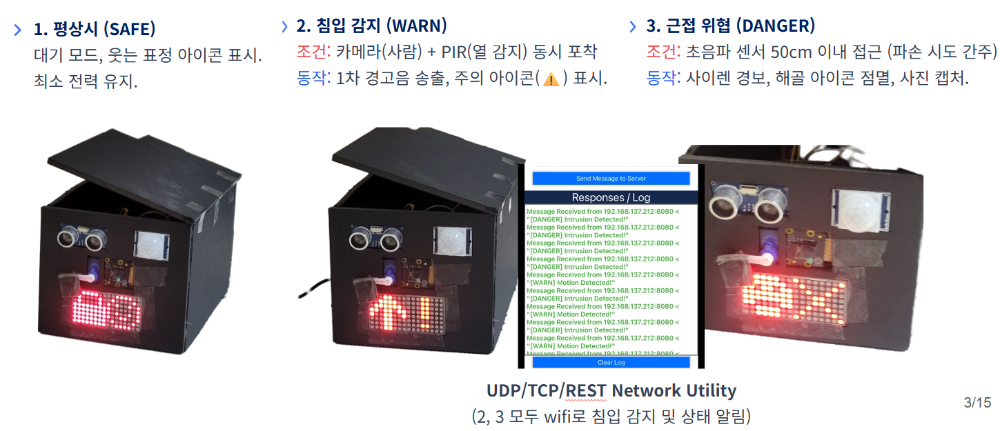
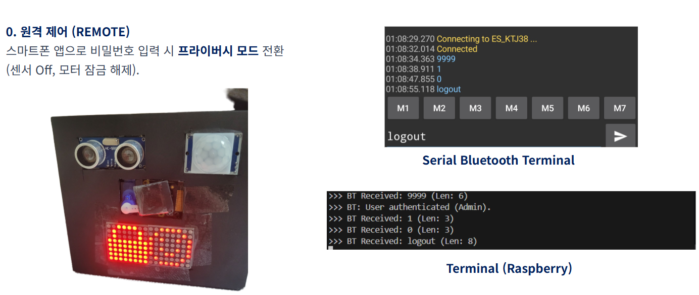

# RaspberryPi_Sentry-System
3학년 2학기 임베디드시스템 Team Project | 라즈베리파이 5 기반 지능형 보안 시스템

<br>

## 1. 개요
- **프로젝트 성격:** 라즈베리파이 5의 고성능 컴퓨팅과 다중 센서를 융합하여 침입 감지부터 능동적 경고 및 원격 제어까지 수행하는 임베디드 보안 시스템
- **주요 기능:**
  - 카메라 이미지 변화 검출(OpenCV) 및 PIR 센서를 활용한 이중 침입 감지
  - 초음파 센서를 통한 50cm 이내 근접 위협 감지 시 자동 사진 캡처 및 증거 확보
  - 상황별(SAFE, WARN, DANGER) 시각적 아이콘(Dot Matrix) 표시 및 경보음(Buzzer) 송출
  - UART(Bluetooth) 통신 기반 사용자 인증 및 서보 모터(도어락) 원격 제어
  - Socket 통신 기반 실시간 침입 로그 서버(Wi-Fi) 전송

<br>

## 2. 시스템 아키텍처

### 하드웨어 및 통신 구조


- **제어 보드:** Raspberry Pi 5
- **파워:** External Adapter (5V 2A)
- **센서:** Pi Camera (OpenCV 영상 처리), PIR Sensor (적외선 동작 감지), Ultrasonic Sensor (거리 측정)
- **액추에이터:** Dot Matrix 8×8 2개 (상태 UI 출력), Active Buzzer (경보음), Servo Motor (잠금 장치)
- **통신:** UART (Bluetooth), SPI (Dot Matrix), Wi-Fi (TCP/IP Socket 통신)

<br>

### 파일 구조
본 프로젝트는 시스템의 유지보수성과 확장성을 높이기 위해, C 언어 기반의 멀티쓰레드 하드웨어 제어부(`src/`, `include/`)와 Python 기반의 비전 처리부(`python/`)로 역할을 명확히 분리한 구조를 채택하였습니다.

```text
├── Makefile                 # C 프로그램 컴파일 및 빌드 자동화 스크립트
│
├── include/                 # [Public API] 모듈 간 참조를 위한 헤더 파일
│   ├── actuators.h          # 도트매트릭스 및 부저 제어 인터페이스
│   ├── bluetooth.h          # UART 블루투스 통신 인터페이스
│   ├── config.h             # 시스템 전역 핀 맵 및 공통 매크로 설정
│   ├── motor.h              # 서보 모터(도어락) 제어 인터페이스
│   ├── network.h            # Wi-Fi 소켓 통신 인터페이스
│   └── sensors.h            # 초음파 및 PIR 센서 제어 인터페이스
│
├── src/                     # [Implementation] C 로직 구현부
│   ├── main.c               # 메인 제어 루프 및 5-Thread 병렬 처리 관리
│   ├── actuators.c          # 시각/청각 알림 하드웨어 구동 로직
│   ├── bluetooth.c          # 안드로이드 터미널 연동 및 인증 로직
│   ├── motor.c              # PWM 기반 서보 모터 각도 제어 로직
│   ├── network.c            # 외부 서버로의 침입 상태 전송 로직
│   └── sensors.c            # 센서 데이터 수집 및 IPC(Named Pipe) 수신 로직
│
└── python/                  # [Vision Processing] 파이썬 보조 시스템
    ├── py_detector.py       # OpenCV 기반 이미지 변화 감지 알고리즘 및 IPC 전송
    └── requirements.txt     # Python 가상환경 패키지 의존성 명세
```

<br>

## 3. 핵심 기능

### 1) 5-Thread 병렬 처리 아키텍처
각 하드웨어 모듈과 통신 모듈을 독립적인 POSIX 쓰레드로 분할하여, 특정 액추에이터의 블로킹 딜레이(예: 부저 멜로디 출력)가 센서의 실시간 감지나 사용자 명령 수신을 방해하지 않도록 설계했습니다.

```c
// [src/main.c] 5개의 독립 쓰레드 생성 및 병렬 구동
pthread_create(&th_disp, NULL, displayThreadFunc, NULL);
pthread_create(&th_buzz, NULL, buzzerThreadFunc, NULL);
pthread_create(&th_pipe_reader, NULL, opencvPipeReadThread, NULL);
pthread_create(&th_bt, NULL, bluetoothThreadFunc, NULL);
pthread_create(&th_wifi, NULL, wifiServerThreadFunc, NULL);
```

### 2) IPC (Named Pipe) 및 Mutex 동기화
- **IPC (FIFO):** 영상 처리에 최적화된 Python과 하드웨어 정밀 제어에 최적화된 C 언어 간 Named Pipe(`/tmp/opencv_fifo`)를 구축하여 이종 언어 간 실시간 데이터를 연동했습니다.
- **Mutex:** 여러 쓰레드가 전역 변수인 시스템 상태(`current_mode`) 및 인증 정보에 동시 접근 시 발생하는 경쟁 상태를 방지하기 위해 `mode_mutex`와 `auth_mutex`를 적용했습니다.

```c
// [src/sensors.c] IPC 파이프 수신 시 Mutex를 통한 공유 자원 보호
if (read(fd, buffer, 1) > 0) {
    pthread_mutex_lock(&mode_mutex);
    if (buffer[0] == '1') opencv_motion_detected = 1;
    else opencv_motion_detected = 0;
    pthread_mutex_unlock(&mode_mutex);
}
```

<br>

## 4. 트러블슈팅

### 1) UART 모듈 활성화에 따른 SPI 핀 점유 및 도트매트릭스 작동 불능
- **Symptom:** 블루투스 통신을 위해 `uart3` 모듈을 활성화하면, 도트매트릭스를 제어하는 SPI 인터페이스가 작동 불능 상태에 빠짐 (`/dev/spidev0.0` 디바이스 노드 소실).
- **Root Cause:** 라즈베리파이 4에서 5로 하드웨어 세대가 변경되면서 `uart3`의 TX, RX 핀 맵이 변경됨. 이에 따라 `dtoverlay=uart3` (GPIO 4, 5)를 활성화할 경우, 시스템이 SPI 핀(GPIO 8, 9)까지 강제로 점유해버리는 핀 충돌 현상이 발생.
- **Resolution:** 센서와 통신 모듈 간의 전면적인 하드웨어 핀 재배치 수행. 기존 초음파 센서가 사용하던 핀(GPIO 14, 15)을 일반 GPIO 4, 5번으로 이동시키고, 블루투스 모듈을 표준 UART 핀(GPIO 14, 15)으로 재할당함으로써 SPI 핀 간섭 현상을 완벽히 해결.

<br>

### 2) 모터 전류에 따른 전압 강하 및 블루투스 페어링 해제
- **Symptom:** 서보 모터가 구동하여 도어락을 제어할 때마다 시스템에 전압 노이즈가 발생하여 블루투스 연결이 간헐적으로 끊어짐.
- **Root Cause:** 라즈베리파이의 단일 전원 회로를 모든 센서와 모터가 공유함에 따라, 모터 구동 시 발생하는 과도한 전류가 전체 시스템의 순간적인 전압 강하를 유발함.
- **Resolution:** 모터 구동용으로 외부 전원 어댑터를 직결하여 전원 회로를 메인 보드와 분리. 추가로 순간 전력 소모의 피크를 낮추기 위해, 소프트웨어적으로 도트매트릭스의 밝기 계수를 하향 조정하여 시스템 전원 안정성 및 통신 신뢰성을 완벽히 확보.

```c
  // MAX7219 초기화
  void initMax7219() {
      ...
      write_MAX7219(REG_INTENSITY, 0x01, 0x01);   // 도트매트릭스의 밝기를 0x09 -> 0x01 로 최소한으로 낮춤
      ...
  }
```

<br>

### 3) PIR 센서 출력 불안정(Flickering) 및 감지 오류
- **Symptom:** 객체가 범위 내에 머물러 있음에도 PIR 센서 데이터 신호가 HIGH/LOW를 빠르게 반복하는 플리커링 발생.
- **Root Cause:** 디지털 PIR 센서 모듈 고유의 하드웨어 감도 한계 및 갱신 주기 불일치.
- **Resolution:** 단발성 감지 신호에 바로 상태를 변경하지 않고, 마지막 HIGH 감지 이후 10초간 상태를 유지시키는 **소프트웨어 래칭(Latching) 타이머 로직**을 구현하여 감지 안정성을 대폭 향상.

**[AS-IS: 기존 코드]** - 단순 센서값 반환 (플리커링 노이즈에 취약)
```c
  int check_pir() {
      return digitalRead(PIR_PIN);
  }
```

**[TO-BE: 개선된 래칭(Latching) 로직]** - 타이머 기반 상태 유지
```c
int check_pir() {
    static unsigned long last_pir_time = 0; // 마지막 감지 시간
    const unsigned long PIR_HOLD_TIME = 10000; // 유지 시간: 10초

    // 1. 실제 센서값 읽기
    int current_state = digitalRead(PIR_PIN);

    // 2. 움직임이 감지되면(HIGH), 타이머 갱신
    if (current_state == 1) {
        last_pir_time = millis(); // 현재 시간(ms) 저장
        return 1; // 감지됨
    }

    // 3. 지금은 LOW지만, 마지막 감지로부터 10초가 안 지났다면?
    if ((millis() - last_pir_time) < PIR_HOLD_TIME) {
        // 아직 사람이 있다고 "거짓말"을 함 (유지 상태)
        return 1;
    }

    // 4. 10초도 지났고 센서도 LOW라면 -> 진짜 없음
    return 0;
}
```

<br>

## 5. 빌드 및 실행 가이드

### 1) 프로젝트 빌드
프로젝트 루트 디렉토리에서 아래 명령어를 통해 C 애플리케이션을 빌드합니다.
```bash
make
```

### 2) 파이썬 가상환경 구축 및 의존성 설치
```bash
python3 -m venv venv
source venv/bin/activate
pip install -r python/requirements.txt
```

### 3) 시스템 실행
C 프로그램 실행 시 파이썬 영상 감지 프로세스(`py_detector.py`)가 자식 프로세스로 자동 실행됩니다.
```bash
source venv/bin/activate
sudo ./sentry_system
```
*(※ `/dev/spidev0.0` 및 GPIO 인터페이스 접근을 위해 `sudo` 권한이 필요합니다.)*

> **참고:** 만약 파이썬 카메라를 따로 디버깅하고 싶다면, `main.c`의 `start_python_detector()`를 주석 처리한 후 아래 명령어로 수동 실행하세요.
> - `sudo python3 python/py_detector.py` (경로 변경됨: python/ 폴더 포함)	


<br>

## 6. 시연 영상
[](https://www.youtube.com/watch?v=PyCjQCQlico) 

**단계별 동작 시나리오:**




  1. **SAFE (평상시):** 대기 상태로 도트매트릭스에 스마일 UI 출력
  2. **WARN (침입 감지):** Pi Camera(영상 변화)와 PIR 센서 이중 포착 시 1차 경고음 및 주의 아이콘 출력
  3. **DANGER (근접 위협):** 초음파 센서 50cm 이내 접근 시 사이렌 송출, 해골 아이콘 점멸 및 증거 사진 자동 [캡처](./docs/danger_capture.jpg)
  4. **REMOTE (원격 해제):** 블루투스 터미널 비밀번호 인증 시 프라이버시 모드 전환 및 도어락 개방

<br>

### 한계점 및 향후 개선 과제
- **현재 한계점:** 움직임 감지 기반이므로 정지 객체에 대해 SAFE 모드로 전환되는 제약, 캡처 이미지의 로컬 스토리지 저장 제약.
- **향후 개선 목표:** 경량 딥러닝 모델(YOLO/MobileNet) 포팅을 통한 객체(사람) 인식 고도화 및 캡처 사진 모바일 실시간 전송 기능 구현.

<br>

## 7. 팀원 및 역할
- **강승우:** Wi-Fi 및 Bluetooth 네트워크 통신 제어
- **강현묵:** Pi Camera 인터페이스 및 OpenCV 영상 처리 알고리즘 구현
- **김태준:** **Dot Matrix, Active Buzzer, Ultrasonic, PIR 센서 하드웨어 제어 및 S/W 구동 모듈 구현**
- **손예슬:** 서보 모터 제어 및 하드웨어 기구 설계
